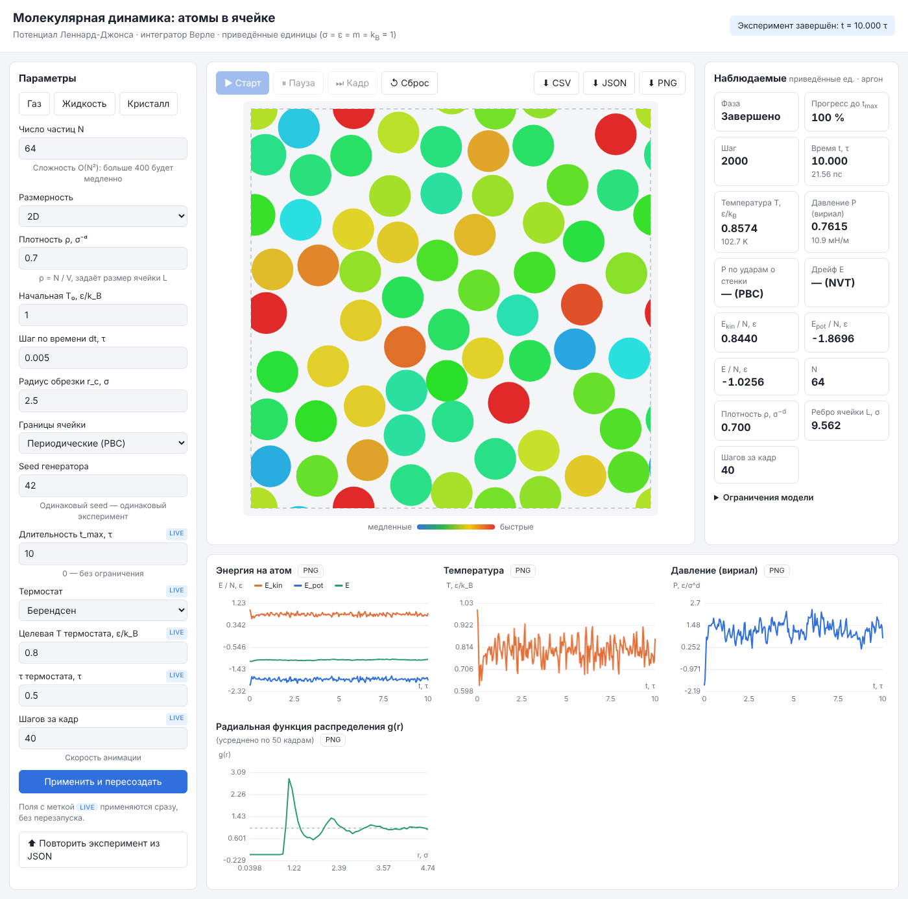

# Lab3TL_LJ — MD: атомы в ячейке (потенциал Леннард-Джонса)

[](https://github.com/Gofmekler/Lab3_TL/actions/workflows/ci.yml)
[](LICENSE)

Веб-приложение для вычислительного эксперимента: движение атомов в ячейке
методом молекулярной динамики. Атомы взаимодействуют по потенциалу
Леннард-Джонса, уравнения движения интегрируются схемой Верле.
Архитектура — **MVVM** (Core → ViewModel → View), ядро верифицировано
по независимым эталонам ([docs/VERIFICATION.md](docs/VERIFICATION.md)).



## Возможности

- 2D и 3D (в 3D ячейку можно вращать мышью);
- периодические граничные условия или отражающие стенки;
- NVE (без термостата) или NVT (Берендсен / масштабирование скоростей);
- длительность эксперимента t<sub>max</sub> и явные фазы: готово, идёт, пауза,
  завершено, сбой расчёта (данные до сбоя сохраняются);
- пресеты «Газ», «Жидкость», «Кристалл»;
- графики энергии, температуры, давления и g(r) с подписями осей и единицами;
- давление двумя способами: по теореме вириала и по ударам о стенки;
- значения в приведённых единицах и в единицах аргона (K, пс, МПа);
- контроль сохранения энергии (дрейф E в NVE);
- экспорт: CSV (с метаданными и единицами), JSON (эксперимент целиком), PNG
  сцены и каждого графика; повтор эксперимента из JSON;
- проверка ввода у каждого поля, понятные сообщения об ошибках и о
  недоступности сервера; панель «Ограничения модели».

## Запуск в PyCharm (macOS)

1. **Python.** Нужен Python 3.10+. Проверьте в Терминале: `python3 --version`.
   Если Python нет — установите с [python.org](https://www.python.org/downloads/macos/)
   или через Homebrew: `brew install python`.
2. **Открыть проект.** PyCharm → *File → Open…* → выберите папку `Lab3TL_LJ`
   (или *Get from VCS* и вставьте ссылку на репозиторий).
3. **Интерпретатор.** PyCharm → *Settings* (⌘,) → *Project: Lab3TL_LJ →
   Python Interpreter* → *Add Interpreter → Add Local Interpreter →
   Virtualenv Environment → New*, базовый интерпретатор — `python3`,
   папка `.venv` внутри проекта → *OK*.
4. **Зависимости.** PyCharm сам предложит установить пакеты из
   `requirements.txt` (жёлтая плашка вверху редактора → *Install requirements*).
   Если плашки нет — откройте вкладку *Terminal* внизу (⌥F12) и выполните:
   ```bash
   pip install -r requirements.txt
   ```
5. **Запуск.** Справа вверху выберите конфигурацию **«Запуск приложения»**
   и нажмите зелёный ▶ (⌃R). Браузер откроется сам на
   <http://127.0.0.1:8000>. Остановка — красный квадрат (⌘F2).
6. **Тесты.** Конфигурация **«Тесты»** → ▶.
7. **Отчёт о верификации** (нужны `pip install -r requirements-dev.txt`):
   конфигурация **«Верификация»** → ▶, результат — `docs/VERIFICATION.md`.

Конфигурации запуска лежат в `.idea/runConfigurations/` и подхватываются
автоматически. Если их не видно в списке — откройте `run.py` и нажмите ▶
рядом с `if __name__ == "__main__":`.

**Частые проблемы**

| Сообщение | Что делать |
|---|---|
| `Не установлена зависимость «flask»` | шаг 4: `pip install -r requirements.txt` в терминале PyCharm |
| `Порт 8000 занят` | приложение уже запущено — остановите старый запуск (⌘F2) или добавьте `--port 8001` в *Edit Configurations… → Parameters* |
| `No Python interpreter configured` | шаг 3 |
| Браузер не открылся | откройте вручную <http://127.0.0.1:8000> (ссылка кликабельна в консоли PyCharm) |
| В интерфейсе «Сервер недоступен» | приложение остановлено — запустите снова (шаг 5) и обновите страницу |

Порт по умолчанию — 8000: на macOS 12+ порт 5000 занят службой AirPlay Receiver.

## Запуск из терминала

```bash
python3 -m venv .venv
source .venv/bin/activate              # Windows: .venv\Scripts\activate
pip install -r requirements.txt
python run.py                          # откроется http://127.0.0.1:8000
```

## Тесты и верификация

```bash
python -m pytest                       # unit, эталоны, контракт API (~30 с)

pip install -r requirements-dev.txt    # инструменты разработчика
python -m playwright install chromium
python -m pytest -m e2e                # сквозные тесты в браузере
ruff check .                           # линтер
python -m verification                 # полный отчёт → docs/VERIFICATION.md (~3 мин)
python scripts/make_screenshots.py     # скриншоты → docs/img/ui_*.png
```

Всё это выполняется в CI на каждый push и pull request
([.github/workflows/ci.yml](.github/workflows/ci.yml)): Linux и macOS,
Python 3.10 и 3.13, плюс запуск приложения и браузерные тесты.

| Уровень | Что проверяется |
|---|---|
| Core | законы сохранения энергии и импульса, F = −∇U, обратимость, PBC и стенки |
| Эталоны | период колебаний молекулы, точка поворота, порядок схемы = 2, P(вириал) = P(стенки), Z = 1 + B₂ρ, распределение Максвелла |
| ViewModel | фазы, команды, валидация (ошибочный ввод не заменяется умолчанием), экспорт/импорт |
| HTTP | контракт `state()`, коды 400/404/405/409/413/422/500, лимиты, изоляция сессий |
| Браузер | страница → HTTP → ViewModel → Core, PNG/CSV/JSON, «сервер недоступен» |

## Структура

```
lj_md/
  core/                  # MODEL — физика, ничего не знает об интерфейсе
    potential.py         #   потенциал LJ (обрезка + сдвиг), сила
    system.py            #   частицы, ячейка, PBC/стенки, силы, T, KE, импульс стенкам
    integrator.py        #   velocity Verlet
    thermostat.py        #   Берендсен, rescale
    observables.py       #   давление (вириал), g(r)
    simulation.py        #   фасад: параметры, инициализация, шаги, t_max, откат при сбое
    units.py             #   пересчёт в единицы аргона
  viewmodel/             # VIEWMODEL — состояние экрана и команды
    observable.py        #   ObservableProperty, Command (аналог INotifyPropertyChanged)
    simulation_vm.py     #   фазы, валидация, команды, данные для графиков, экспорт
  view/                  # VIEW — веб-интерфейс
    app.py               #   Flask: тонкие маршруты к ViewModel, коды ошибок, лимиты
    templates/index.html #   разметка с data-bind / data-command
    static/app.js        #   привязка DOM ↔ состояние ViewModel
    static/scene.js      #   отрисовка атомов (2D/3D)
    static/charts.js     #   графики на canvas, PNG
verification/            # эталонные проверки и генератор docs/VERIFICATION.md
tests/                   # тесты по слоям + e2e в браузере
scripts/                 # скриншоты для документации
docs/                    # архитектура, API, роли, теория, верификация, отчёт
run.py                   # точка входа
```

## Документация

- [docs/ARCHITECTURE.md](docs/ARCHITECTURE.md) — как устроен MVVM и почему так;
- [docs/API.md](docs/API.md) — контракт View ↔ ViewModel, коды ошибок, форматы экспорта;
- [docs/THEORY.md](docs/THEORY.md) — физическая модель, численные методы, ограничения;
- [docs/VERIFICATION.md](docs/VERIFICATION.md) — результаты эталонных проверок;
- [docs/REPORT.md](docs/REPORT.md) — черновик отчёта по лабораторной;
- [docs/ROLES.md](docs/ROLES.md) и [CONTRIBUTING.md](CONTRIBUTING.md) — роли, ветки, review, Definition of Done;
- [docs/AUDIT_CHECKLIST.md](docs/AUDIT_CHECKLIST.md) — самопроверка по критериям курса;
- [docs/DESKTOP.md](docs/DESKTOP.md) — сборка в один исполняемый файл, чтобы отправить приложение без установки Python.

## Лицензия

[MIT](LICENSE).
