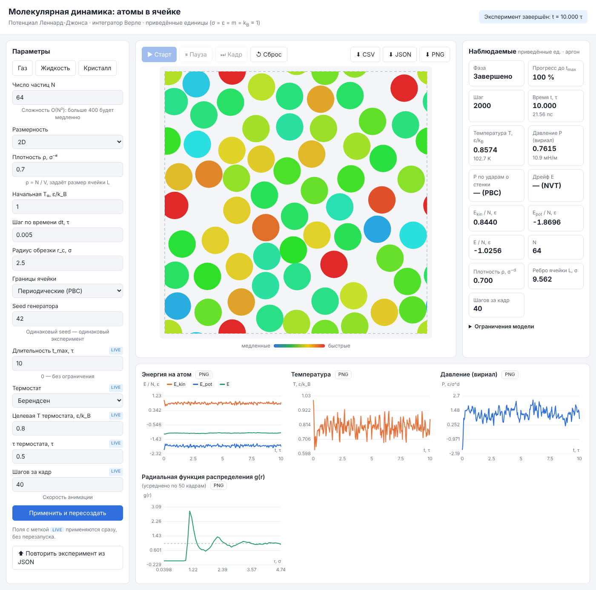
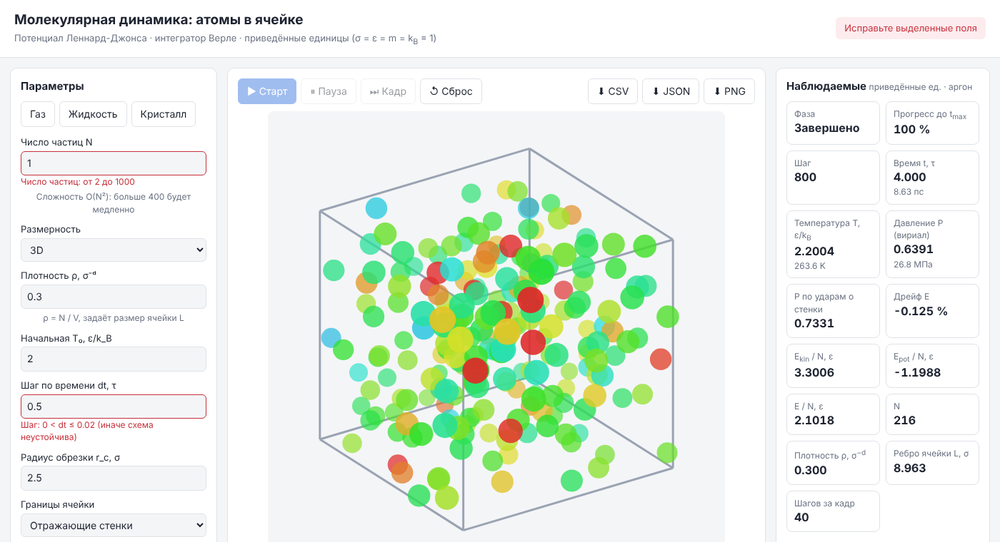
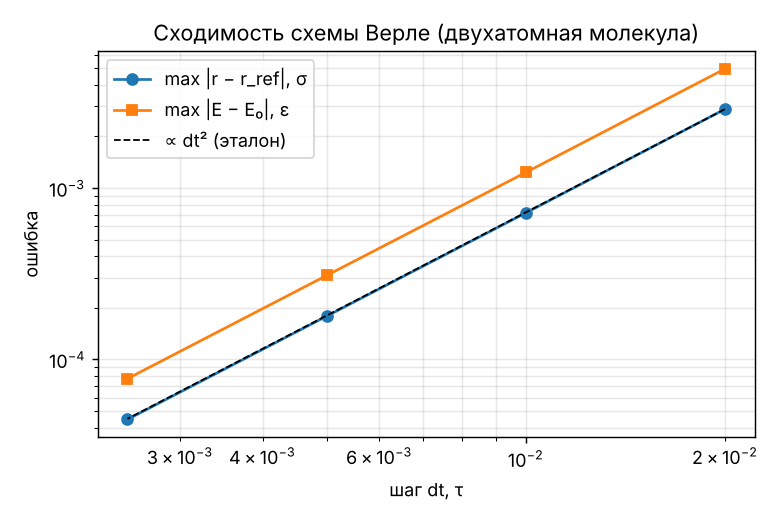
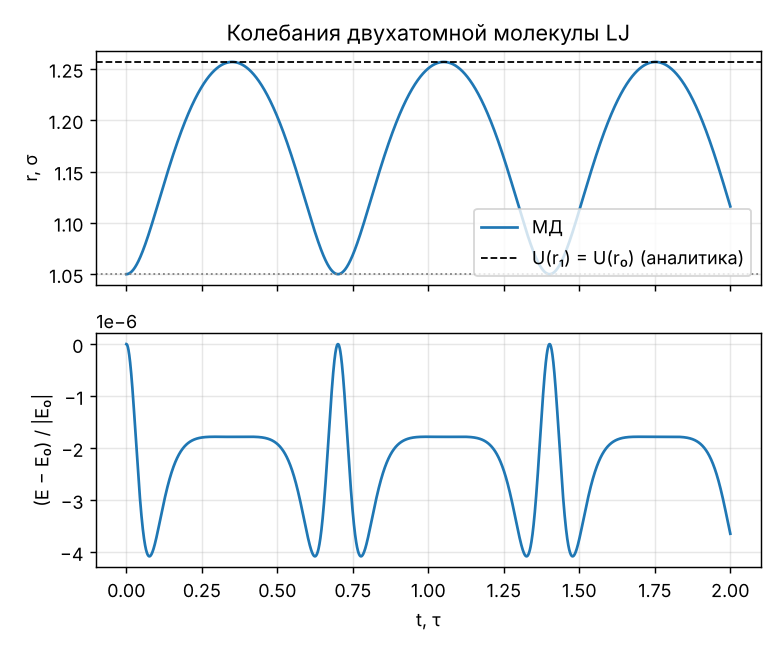
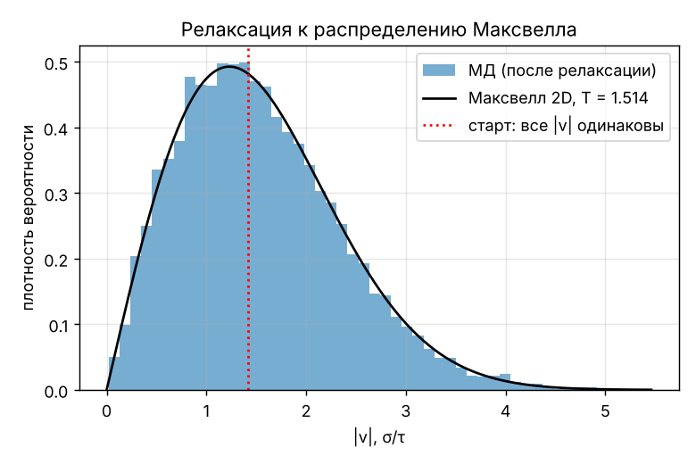
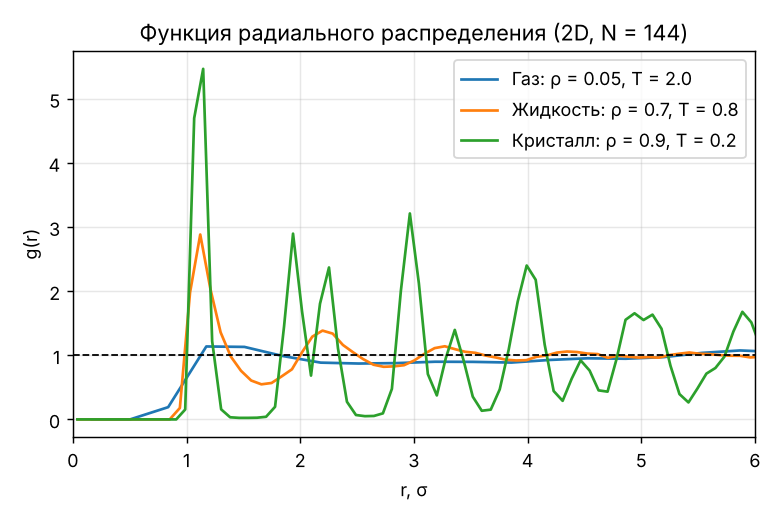

# Отчёт по лабораторной работе

**Тема:** молекулярная динамика — атомы в ячейке с потенциалом Леннард-Джонса
**Команда:** <!-- ФИО: тимлид, core, UI --> · **Группа:** <!-- --> · **Дата:** <!-- -->

> Черновик. Числа взяты из [VERIFICATION.md](VERIFICATION.md) (генерируется
> `python -m verification`, результаты воспроизводимы: фиксированные seed).
> Перед сдачей впишите состав команды и сформулируйте выводы своими словами.

## 1. Цель работы

Построить вычислительный эксперимент — модель системы атомов в ячейке,
взаимодействующих по потенциалу Леннард-Джонса; реализовать численное
интегрирование уравнений движения, проверить его корректность по независимым
эталонам и исследовать структуру и термодинамику газа, жидкости и кристалла.

## 2. Физическая модель

- Потенциал: U(r) = 4ε[(σ/r)¹² − (σ/r)⁶], обрезка на r<sub>c</sub> = 2.5σ со сдвигом.
- Уравнения Ньютона m r̈<sub>i</sub> = −∇<sub>i</sub> Σ U(r<sub>ij</sub>).
- Границы: периодические (ближайший образ) или отражающие стенки.
- Ансамбли: NVE, либо NVT с термостатом Берендсена.
- Приведённые единицы σ = ε = m = k<sub>B</sub> = 1; для аргона T* = 1 ↔ 119.8 K, τ ≈ 2.15 пс.

Подробно — [THEORY.md](THEORY.md). Ограничения модели перечислены там же и
в интерфейсе (панель «Ограничения модели»).

## 3. Численный метод

Схема Верле в скоростной форме (второй порядок, симплектическая, обратимая).
Шаг dt = 0.005τ по умолчанию; после каждого шага контролируются конечность
величин и смещение атома (< σ/2), при нарушении — откат и сообщение
«Сбой расчёта». Длительность эксперимента t<sub>max</sub> задаётся явно.

## 4. Программная реализация

Веб-приложение на Python, архитектура MVVM:
Core (`lj_md/core`, NumPy) → ViewModel (`lj_md/viewmodel`) → View
(`lj_md/view`, Flask + HTML/JS). Контракт между слоями — [API.md](API.md),
архитектура — [ARCHITECTURE.md](ARCHITECTURE.md).






## 5. Верификация

| Проверка | Эталон | Результат МД | Расхождение |
|---|---|---|---|
| Период малых колебаний молекулы | 2π√(μ/U″(r<sub>min</sub>)) = 0.587720τ | 0.587976τ | 4.4·10⁻⁴ |
| Точка поворота при r₀ = 1.05σ | U(r₁) = U(r₀): r₁ = 1.2567700σ | 1.2567694σ | 4.7·10⁻⁷ |
| Порядок схемы (dt … dt/8) | p = 2 | p = 2.004 | — |
| Флуктуации E в NVE (64 атома) | ∝ dt² | наклон 2.06 | — |
| Давление (стенки, ρ = 0.3) | вириал 0.5084 ± 0.0059 | удары 0.5100 | 0.3 % |
| Z при ρ = 0.05, T = 2 | 1 + B₂ρ = 1.0234 | 1.0222 ± 0.0022 | в пределах ошибки |
| Распределение скоростей | Максвелл: ⟨v⁴⟩/⟨v²⟩² = 2 | 2.04 (старт 1.02) | 2 % |







## 6. Результаты эксперимента: газ, жидкость, кристалл

2D, N = 144, NVT. g(r) усреднена по 60 кадрам после уравновешивания.

| Состояние | ρ | T | E<sub>pot</sub>/N, ε | первый пик g(r), σ | высота пика |
|---|---|---|---|---|---|
| Газ | 0.05 | 2.00 | −0.09 | 1.17 | 1.14 |
| Жидкость | 0.70 | 0.80 | −1.85 | 1.12 | 2.88 |
| Кристалл | 0.90 | 0.20 | −2.89 | 1.15 | 5.47 |



Наблюдения:

- первый пик g(r) во всех фазах расположен вблизи минимума потенциала
  r<sub>min</sub> = 2<sup>1/6</sup>σ ≈ 1.12σ — расстояние между ближайшими соседями;
- в газе корреляции слабые (пик ≈ 1.1, далее g ≈ 1), в жидкости — ближний порядок
  с затухающими осцилляциями, в кристалле — острые пики координационных сфер
  (дальний порядок);
- потенциальная энергия на атом понижается от газа к кристаллу: атомы
  проводят больше времени вблизи минимумов потенциала соседей.

## 7. Выводы

<!-- Сформулируйте своими словами. Опорные пункты: -->

1. Схема Верле имеет второй порядок точности (p = 2.00) и сохраняет энергию
   без систематического дрейфа; остаточные флуктуации связаны с шагом и
   разрывом силы на r<sub>c</sub>.
2. Модель воспроизводит аналитические результаты для двухатомной молекулы
   и вириальное уравнение состояния при малой плотности.
3. Два независимых способа измерения давления согласуются в пределах
   статистической ошибки.
4. По g(r) и E<sub>pot</sub> чётко различаются газ, жидкость и кристалл.

## Приложение: как воспроизвести

```bash
pip install -r requirements-dev.txt
python -m verification                 # таблицы и графики разделов 5–6
python run.py                          # интерфейс; экспорт CSV/JSON/PNG — кнопки на панели
```
