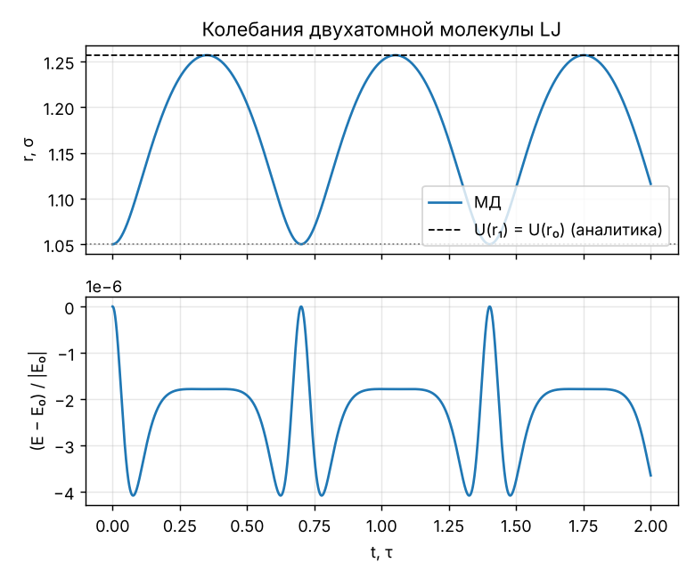
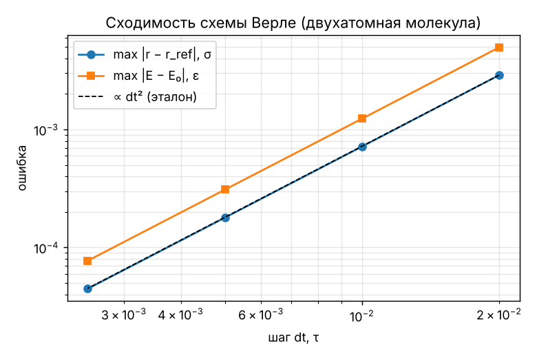
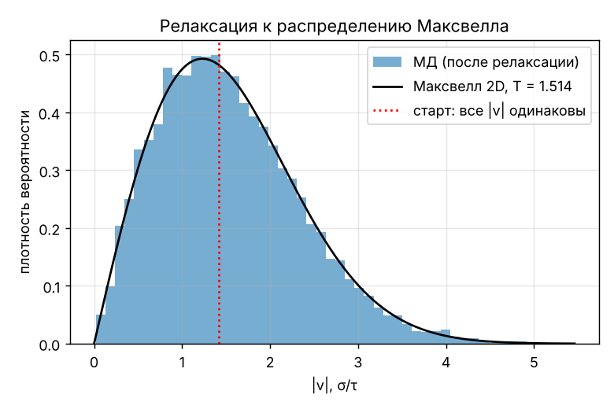
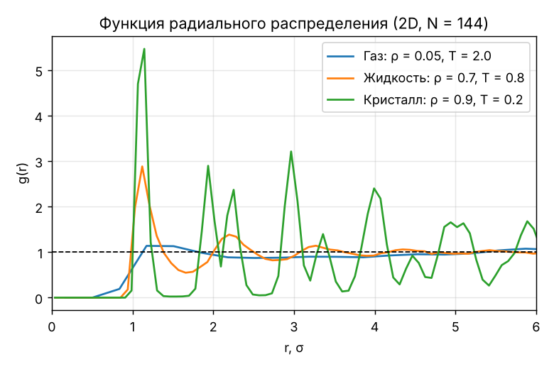

# Верификация вычислительного ядра

> Сгенерировано командой `python -m verification` · lj_md 1.1.0 · Python 3.13.16 · NumPy 2.5.4 · 2026-10-27 14:44 UTC · 148 с.
> Не редактируйте вручную — перезапустите генератор.

Каждый результат МД сравнивается с **независимым эталоном** — аналитической
формулой, законом сохранения или другим способом измерения той же величины.
Эталонные формулы записаны отдельно от ядра (`verification/cases.py`).
Те же проверки с уменьшенными размерами выполняются в CI (`tests/test_verification.py`).

## Сводка

| Проверка | Результат |
|---|---|
| Период малых колебаний молекулы | ✅ |
| Точка поворота (сохранение энергии) | ✅ |
| Порядок сходимости Верле ≈ 2 | ✅ |
| Флуктуации E ∝ dt² (многочастичная система) | ✅ |
| P вириал = P по ударам о стенки | ✅ |
| Z = 1 + B₂ρ при малой плотности | ✅ |
| Релаксация к распределению Максвелла | ✅ |
| Упорядоченность растёт: газ → жидкость → кристалл | ✅ |

## 1. Двухатомная молекула: период малых колебаний

Эталон: гармоническое приближение у минимума, k = U″(r_min) = 36·2^(2/3) ε/σ²,
приведённая масса μ = m/2, T = 2π√(μ/k).

| Величина | Значение |
|---|---|
| k = U″(r_min) | 57.146438 ε/σ² |
| T аналитически | 0.587720 τ |
| T из МД (амплитуда 0.005σ, dt = 0.0005) | 0.587976 τ |
| Относительная ошибка | 4.37e-04 |

## 2. Двухатомная молекула: точка поворота

Старт из покоя при r₀ = 1.05σ. По закону сохранения энергии вторая точка
поворота r₁ — корень U(r₁) = U(r₀) (бисекция по формуле потенциала).

| Величина | Значение |
|---|---|
| r₁ аналитически | 1.2567700 σ |
| max r(t) в МД | 1.2567694 σ |
| Относительная ошибка | 4.67e-07 |
| max \|E − E₀\|/\|E₀\| | 4.08e-06 |

## 3. Сходимость по шагу: dt, dt/2, dt/4, dt/8

Эталон — та же задача с шагом dt/512. Для схемы второго порядка ошибка
уменьшается в 4 раза при уменьшении шага вдвое: p = log₂(ε(dt)/ε(dt/2)) ≈ 2.

| dt, τ | max \|r − r_ref\|, σ | p (по r) | max \|E − E₀\|, ε | p (по E) |
|---|---|---|---|---|
| 0.02 | 2.886e-03 | — | 4.960e-03 | — |
| 0.01 | 7.166e-04 | 2.010 | 1.234e-03 | 2.007 |
| 0.005 | 1.789e-04 | 2.002 | 3.091e-04 | 1.997 |
| 0.0025 | 4.470e-05 | 2.001 | 7.727e-05 | 2.000 |

Средний порядок: **p = 2.004** (по координате), **2.001** (по энергии).

## 4. Сохранение энергии в NVE (64 атома, ρ = 0.5, T₀ = 1, 5 τ)

| dt, τ | размах E/N, ε | дрейф E/N (2-я половина − 1-я), ε |
|---|---|---|
| 0.008 | 5.74e-03 | 6.60e-06 |
| 0.004 | 1.81e-03 | 5.27e-06 |
| 0.002 | 3.30e-04 | 1.64e-05 |

Наклон log(размах) от log(dt) по МНК: **2.06** (эталон 2). Отношения
соседних уровней шумят: в хаотической многочастичной системе на ошибку
накладываются скачки энергии при пересечении атомами радиуса обрезки r_c
(разрыв силы, см. ограничения модели), которые не масштабируются как dt².
Систематического дрейфа нет — он на 1–2 порядка меньше флуктуаций.

## 5. Давление двумя независимыми способами (отражающие стенки)

1. Теорема вириала: P = (N T + Σ r_ij·F_ij / d) / V.
2. Механическое определение: импульс, переданный стенкам, P = Σ 2m|v_n| / (A·Δt).

| Способ | P, ε/σ² |
|---|---|
| Вириал | 0.5084 ± 0.0059 |
| Удары о стенки | 0.5100 |
| Относительная разница | 0.32% |

## 6. Уравнение состояния при малой плотности: второй вириальный коэффициент

Эталон: Z = P/(ρT) = 1 + B₂(T)·ρ + O(ρ²), где B₂(T) = −π∫(e^(−U/T) − 1) r dr
вычислен квадратурой по формуле потенциала (2D, r_c = 2.5σ, сдвиг).

| Величина | Значение |
|---|---|
| T (среднее в МД) | 2.0001 |
| B₂(T) | 0.4675 σ² |
| Z идеального газа | 1 |
| Z = 1 + B₂ρ (эталон, ρ = 0.05) | 1.0234 |
| Z из МД | 1.0222 ± 0.0022 |

## 7. Релаксация распределения скоростей

Старт: у всех атомов одинаковый модуль скорости (⟨v⁴⟩/⟨v²⟩² = 1). После
столкновений распределение должно стать максвелловским; для 2D
⟨v⁴⟩/⟨v²⟩² = 2.

| Момент | ⟨v⁴⟩/⟨v²⟩² |
|---|---|
| Старт | 1.015 |
| После релаксации | 2.041 |
| Максвелл (эталон) | 2.000 |

## 8. Структура газа, жидкости и кристалла (качественная проверка)

NVT (Берендсен), 144 атома, 1500 шагов уравновешивания, g(r) усреднена по 60 кадрам.
Ожидается: у газа g(r) ≈ 1 с малым пиком, у жидкости — пик ≈ 2.5–3 и затухающие
осцилляции, у кристалла — острые пики координационных сфер; первый пик у r ≈ 2^(1/6)σ.

| Фаза | ρ | T (среднее) | E_pot/N, ε | положение пика, σ | высота пика |
|---|---|---|---|---|---|
| Газ | 0.05 | 2.000 | -0.086 | 1.174 | 1.14 |
| Жидкость | 0.7 | 0.799 | -1.845 | 1.121 | 2.88 |
| Кристалл | 0.9 | 0.202 | -2.892 | 1.146 | 5.47 |

## Дополнительные автотесты

В `tests/test_core.py`: F = −∇U (численная производная), третий закон Ньютона,
сохранение импульса при PBC, обратимость схемы во времени, предел идеального
газа P → ρT, g(r) → 1 для идеального газа, первый пик g(r) жидкости у r ≈ σ.
